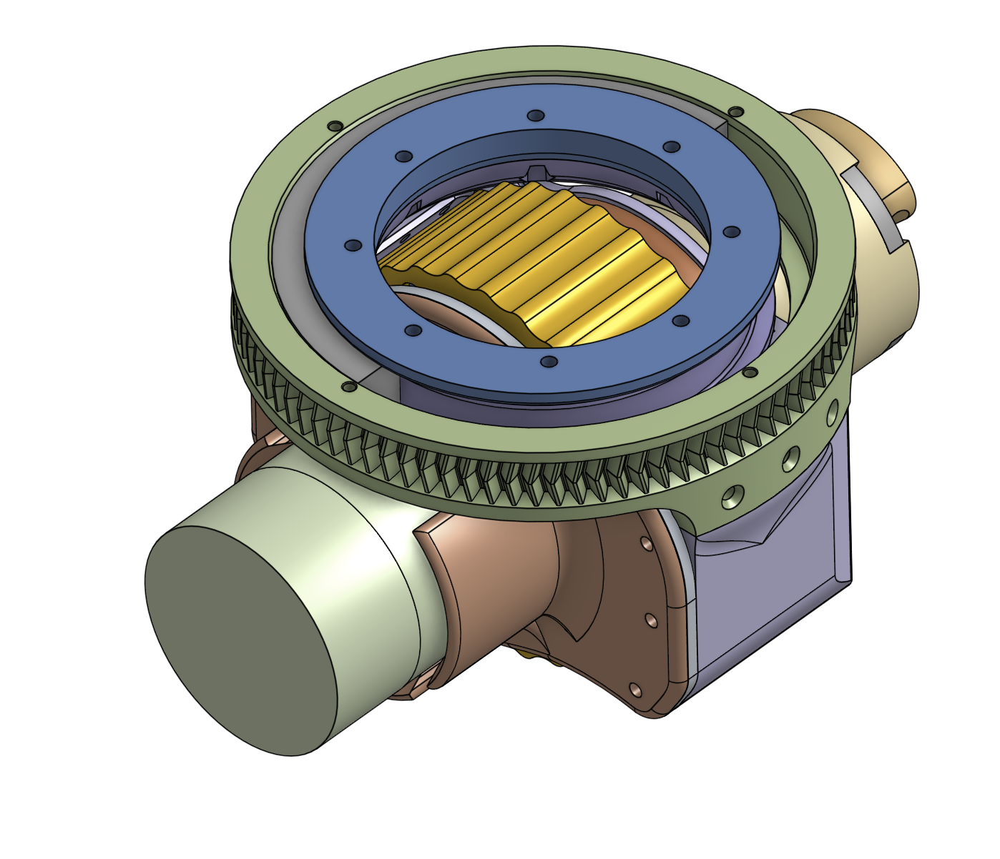
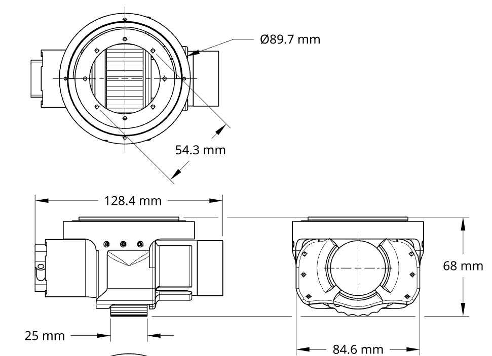
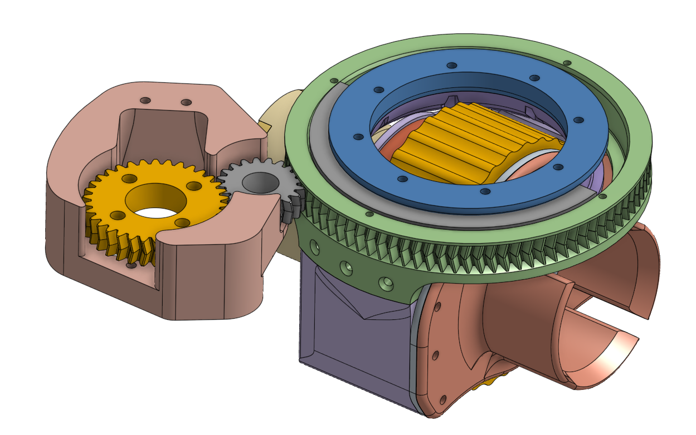
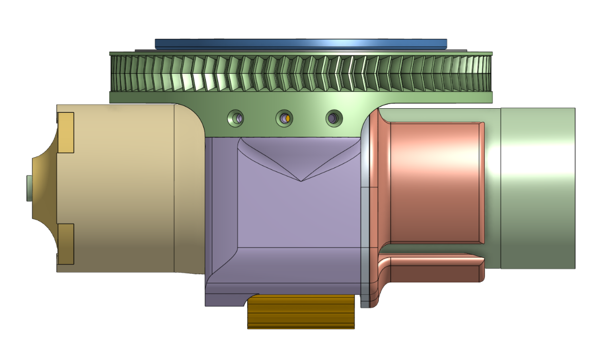
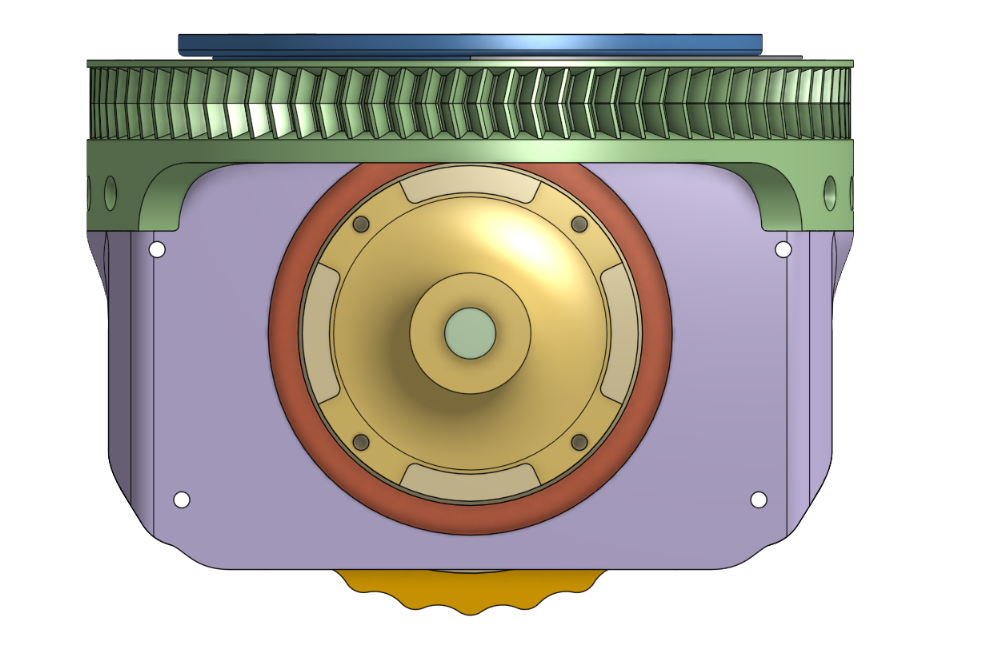
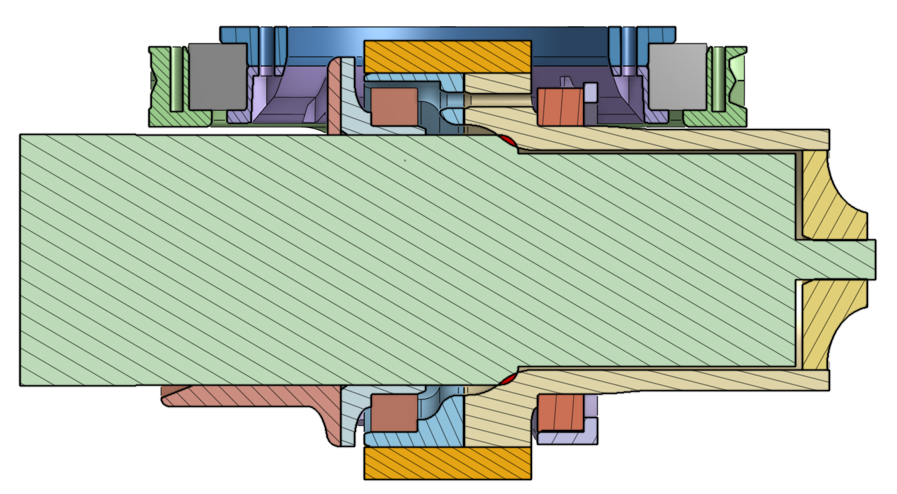

# InCoreSwerve — Open-Source FTC Swerve Module

**The world's most height-compact swerve drive?**

The goal of this project is to build a cheap, 3D-printed, height-compact swerve drive.

  

A height-compact swerve module that leaves the space above the drivetrain free for other mechanisms. The drive motor sits inside the wheel, so the whole module is only **76.5 mm tall**, just 4.5 mm taller than the wheel. Almost every part is 3D printed, so it's cheap and quick to build.

**[Open the CAD in Onshape](https://cad.onshape.com/documents/fb4aa81e9363d77e91ba855e/w/5e529175e5736a5771553f14/e/259a945b591e18a8a6eb1364?configuration=List_zoWPqZ70dBiZAY%3DDefault&renderMode=0&uiState=6ae8e9434939611f64f78238)** · **[Download STEP / STL](cad/)** · **[Bill of Materials](bom/BOM.csv)** · **[Assembly Guide](docs/assembly.md)**

---

## Key specs

| Spec | Value |
|---|---|
| Footprint | 160 × 160 mm |
| Height | 76.5 mm (4.5 mm above the wheel) |
| Weight (per module) | [__ g] |
| Drive motor | goBILDA 312 RPM, inside the wheel |
| Drive gear ratio | 1:1 (motor drives the wheel directly) |
| Wheel | 66 mm diameter |
| Theoretical top speed | ≈ 1.08 m/s (free speed) |
| Steering actuator | Axon MINI Servo MK2 |
| Steering sensor | [absolute encoder model, analog/digital] |
| Steering ratio | 2.5:1 |
| Moving parts | 3 (not counting the motor's gearbox and the servo) |
| Cost per module | \$30.42 (without servo and motor) |
| Assembly time | Under 3 h for the full four-module drive |
| Manufacturing | 3D printed, except the motor, bearings, screws and one clamp |

  
   <em>Dimensioned drawing: top, side and front views</em>

## Status

**Version:** v1.0, working prototype. The module has been shown to work, but it has had limited testing so far, so long-term reliability isn't proven yet.

## Two versions

The Onshape document has two versions of the module:

- **Servo under the chassis (recommended).** The most compact version, but it hasn't been tested on a robot yet.
-  **Servo on top.** The steering servo sits above the module, so it sticks up more, but it's the simpler build. On many robots, the servo fits in space that would otherwise be empty anyway.

## Gallery

| | | |
|:---:|:---:|:---:|
|  |  |  |
| Module with the steering gear stage | Side view: wheel below, ring gear on top | Front view: motor face inside the housing |

[Link to a short video of the drivetrain driving, if you have one.]

## Strengths and weaknesses

**Strengths**

- **Very low profile.** 76.5 mm tall, only 4.5 mm above the wheel, so the space on top stays free for other mechanisms.
- **Only 5 moving parts.** That's fewer things to wear out or misalign.
- **Cheap.** About \$30 per module (≈ \$120 for the full drive) in bearings, screws and a clamp, assuming you already have the motors and hubs, like most teams do.
- **Quick to build.** The full four-module swerve drive goes together in under 3 hours.
- **Easy to modify.** Almost every part is 3D printed, so a design change means a reprint, not a machining job.
- **Fits many chassis.** It adapts to a wide range of chassis designs.

**Weaknesses**

- **Specific bearing sizes.** It's designed specifically around 6808 and 61812 bearings.
- **Limited testing.** It works, but it hasn't been run long enough to prove long-term reliability.

**FTC legality:** [All parts are COTS / legal under the current Game Manual rule R___]. Teams should always check the current season's manual.

## Bill of materials (per module)

Multiply by 4 for a full swerve drive. A spreadsheet version is in [bom/BOM.csv](bom/BOM.csv).

| Part | Qty | Approx. cost (USD) | Notes |
|---|---|---|---|
| 6808 bearing (40 × 52 × 7 mm) | 2 | \$9.20 (\$4.60 each) | Wheel bearings, around the motor |
| 61812 bearing (60 × 78 × 10 mm) | 1 | \$8.50 | Steering bearing (the module turns on it) |
| M2 × 15 mm screw | 32 | \$5.30 | |
| M2 nut | 8 | \$0.21 | |
| Clamp, fits a diameter of more than 45 mm | 1 | \$5.00 | |
| PLA filament | 67.5 g | \$1.66 | Structural parts |
| TPU filament | 12.22 g | \$0.55 | Wheel |
| goBILDA motor, 312 RPM | 1 | \$54.99 (most teams already have one) | Drives the wheel 1:1 |
| Axon MINI Servo MK2 | 1 | \$99.99 (most teams already have one) | Steering |
| **Per module, team already has motor and servo** | | **\$30.42** | |
| **Per module, starting from zero** | | **\$185.40** | |
| **Full swerve (×4), team already has motors and servos** | | **\$121.68** | |

## CAD

- **Onshape (source of truth):** [InCoreSwerve on Onshape](https://cad.onshape.com/documents/fb4aa81e9363d77e91ba855e/w/5e529175e5736a5771553f14/e/259a945b591e18a8a6eb1364?configuration=List_zoWPqZ70dBiZAY%3DDefault&renderMode=0&uiState=6ae8e9434939611f64f78238)
- **Exports:** STEP and STL for every release live in [`cad/`](cad/), so the design stays usable even if the Onshape link changes.
- **To modify:** open the Onshape document and click **Make a copy**. Key variables are in the **[Variables / Configuration]** tab ([e.g. wheel size, gear ratio]).

## How it works

  
   <em>Section view. The drive motor (green) sits inside the wheel (orange). The wheel spins around the motor on two 6808 bearings, and the whole module steers on the large 61812 bearing at the top.</em>

The whole design is built around putting the drive motor inside the wheel. The motor sits at the center of a sandwich: the wheel spins around the motor on two 6808 bearings, and the whole module turns on one large 61812 bearing at the top, driven by the servo through the ring gear. Leaving out the motor's internal gearbox and the steering servo, the module has only **three moving parts**.

The large steering bearing is what makes this layout possible, and it's also the design's biggest drawback, because 61812 bearings aren't always easy to find.

3D printing made the design much simpler. Printed parts can fill every gap around the motor and bearings, so the structure uses space a machined part couldn't. Getting everything to fit in CAD takes some careful work, but nothing complicated, and the motor-in-wheel layout has worked very well for me.

**Limits.** The module could be even shorter, but the wheel diameter sets the limit: the wheel has to be big enough to fit the motor inside it.

**Footprint.** Many low-profile swerve modules give up a lot of horizontal space to gain height. This one doesn't. Its envelope takes up about 35% of [reference area] below 76.5 mm, and in practice it uses closer to 25% of the usable space, which makes it very competitive on this metric.

## Known issues & roadmap

- [ ] More testing to prove long-term reliability
- [ ] Test the servo-under-chassis version on a robot
- [ ] Find easier-to-source alternatives to the 6808 / 61812 bearings

## Changelog

- **v1.0** (2026-11-02) — First public release.

## Contributing

Issues and pull requests are welcome — bug reports, build photos, and improvements especially. If you build one, open an issue or discussion with a photo; I'd love to see it.

## License

This project uses separate licenses for hardware and documentation:

- **Hardware** (CAD files, drawings, BOM in `cad/` and `bom/`): [CERN Open Hardware Licence Version 2 – Permissive (CERN-OHL-P-2.0)](LICENSE)
- **Documentation** (text and images in `docs/`, `images/` and this README): [Creative Commons Attribution 4.0 International (CC BY 4.0)](LICENSE-docs)
- **Software** (if any, in `software/`): [MIT / Apache-2.0](LICENSE-software)

You may use, modify, and build this module — including commercially — as long as you keep the copyright and license notices and give credit.

**Suggested attribution:** "InCoreSwerve by Rafa ([GitHub link]), licensed under CERN-OHL-P-2.0 / CC BY 4.0."

## Credits

Designed by **Rafa** with team #21178. Thanks to anyone whose parts, designs, or advice you built on.
